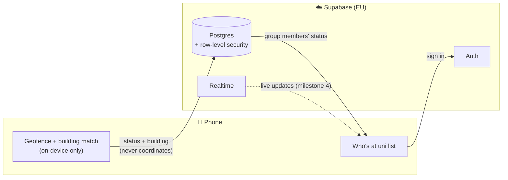

# Uni Radar

[](https://github.com/ahmedk282005/uni-radar/actions/workflows/ci.yml)


[](LICENSE)

**See at a glance which of your friends are on campus right now — without anyone having to type a thing.**

Uni Radar is a privacy-first mobile app (iOS + Android) for a private friend group at
[TUHH](https://www.tuhh.de) (Hamburg University of Technology). It detects when a friend
arrives on or leaves campus via geofencing and shows the group who's at uni and roughly
which building they're near.

> 🚧 **Work in progress** — milestones 1–3 of 7 are done (accounts, groups, live data
> model with row-level security). Automatic campus detection is next. See the [roadmap](#roadmap).

---

## Why

Every day the same question in our group chat: *"Bist du an der Uni?"* — and half the time
nobody answers. Uni Radar replaces that question with a list that keeps itself up to date.

## Features

| | Feature | Status |
|---|---|---|
| 👤 | Email sign-up / sign-in, session kept across app restarts | ✅ |
| 👥 | Private groups with short, unambiguous invite codes (e.g. `K7QX3M`) and native sharing | ✅ |
| 📋 | "Who's at uni" list: people on campus first, "at uni since 09:12 · near building H" | ✅ |
| 🔒 | Database-enforced privacy: you only ever see people who share a group with you | ✅ |
| ⚡ | Manual at-uni toggle with live updates on friends' phones (Supabase Realtime) | ⏳ Milestone 4 |
| 📍 | Automatic campus detection via background geofencing, even with the app closed | ⏳ Milestone 5 |
| 🏛️ | Approximate building ("near building H") + one-tap **ghost mode** | ⏳ Milestone 6 |

## Privacy by design

Location apps are creepy by default. Uni Radar is built so that the server **can't** know
where you are — not just that it promises not to look.

- **No coordinates ever leave the phone.** GPS is only used on the device to answer two
  questions: *"am I on campus?"* and *"which building is closest?"*. The server only receives
  `at_uni` / `not_at_uni` / `hidden`, a building name, and a timestamp.
- **No location history.** Each user has exactly one presence row that is overwritten —
  there is no table that could ever hold a trail of movements.
- **Campus only.** Outside the campus geofence the app knows nothing about where you are.
- **Ghost mode wins.** When hidden, no updates are sent from any code path. The database
  additionally refuses a building for anyone who isn't `at_uni`, so a hidden user can't leak one
  even through a bug.
- **Stale data is labelled, not trusted.** An "at uni" older than 12 hours is shown as
  *Unknown* (e.g. the phone died on campus).
- **EU hosting** (Supabase, Frankfurt).

## Architecture



### Security model

Security lives in the database, not in the app — a modified client can't see more than it's
allowed to.

| Table | Read | Write |
|---|---|---|
| `profiles` | own row + people who share a group | own `display_name` / `avatar_url` only |
| `presence` | own row + people who share a group | own `status` / `building` only; `updated_at` is stamped by a trigger |
| `groups` | groups you're a member of | only via `create_group()` |
| `group_members` | memberships of your groups | only via `create_group()` / `join_group()` |

- **Two layers:** explicit `GRANT`s decide *which tables* a role can touch at all (signed-out
  users get nothing), row-level security decides *which rows*.
- **Invite codes can't be browsed.** Groups are created and joined only through two
  `SECURITY DEFINER` functions that act strictly for the signed-in caller. Codes are 6 symbols
  from a 31-character alphabet without look-alikes (`0/O`, `1/I/L`) — about 887 million
  combinations, generated with cryptographically secure randomness.
- **Recursion-safe policies.** "Who's in my groups?" is answered by small helper functions in a
  non-exposed schema, avoiding the classic infinite-recursion trap of self-referencing RLS.
- **Tested from the inside:** policies were verified by impersonating real users in SQL,
  including a signed-in *stranger* account that must see nothing, and an attempt to modify
  another user's status (0 rows changed).

See [`supabase/migrations/`](supabase/migrations) for the full SQL, commented line by line.

## Tech stack

| Layer | Choice |
|---|---|
| App | [Expo](https://expo.dev) SDK 58 (React Native) · TypeScript (strict) · Expo Router |
| Backend | [Supabase](https://supabase.com): Auth, Postgres with RLS, Realtime |
| Location | `expo-location` + `expo-task-manager` (background geofencing) |
| Testing | Jest (`jest-expo`) for pure logic · GitHub Actions CI |

## Project structure

```
src/
  app/                 # screens (Expo Router — every file is a route)
    _layout.tsx        # auth + group gate: decides which screens are reachable
    sign-in.tsx        # sign in / create account
    group-setup.tsx    # create or join a group
    index.tsx          # "Who's at uni"
  features/
    auth/              # session context, sign-up/in/out, validation
    groups/            # invite codes, create/join, current group context
    presence/          # status types, display rules (12 h rule, sorting), fetching
  lib/supabase.ts      # the single Supabase client
supabase/migrations/   # schema, RLS policies, triggers, RPC functions
docs/SPEC.md           # product spec
```

## Getting started

**Prerequisites:** Node.js 24, a free [Supabase](https://supabase.com) project, and an
iPhone or Android phone with [Expo Go](https://expo.dev/go). (Web is not supported — the core
feature, background geofencing, needs a native app.)

1. **Install**
   ```bash
   git clone https://github.com/ahmedk282005/uni-radar.git
   cd uni-radar
   npm install
   ```
2. **Database** — in your Supabase project's SQL editor, run the files in
   [`supabase/migrations/`](supabase/migrations) in order (oldest first).
3. **Auth** — for local development, turn off *Authentication → Sign In / Providers → Email →
   Confirm email*.
4. **Environment** — copy `.env.example` to `.env` and fill in your project URL and
   **publishable** key (never the secret key).
5. **Run**
   ```bash
   npx expo start
   ```
   Scan the QR code with Expo Go.

## Testing

```bash
npx tsc --noEmit   # type-check
npm test           # unit tests
```

Pure logic — status display rules (incl. the 12-hour rule), invite codes, input validation,
database-row mapping — is unit-tested and runs in CI on every push. Each feature is
additionally checked by hand on a real Android phone before it's merged.

## Roadmap

| # | Milestone | Status |
|---|---|---|
| 1 | Expo app running on a real phone | ✅ |
| 2 | "Who's at uni" list with fake data — components, state, loading/error states | ✅ |
| 3 | Supabase auth, groups, invite codes, row-level security | ✅ |
| 4 | Manual at-uni toggle with live updates (Realtime) | ⏳ next |
| 5 | Automatic background geofencing (development builds) | ⏳ |
| 6 | Building estimate + ghost mode | ⏳ |
| 7 | Beta with friends (TestFlight + Android) | ⏳ |

## How this was built

I built Uni Radar step by step with
[Claude Code](https://claude.com/claude-code) as an AI pair programmer: each milestone was
planned first, every new concept explained, and every step verified on a real phone before
moving on. Commits written together are marked with `Co-Authored-By: Claude`.
[`CLAUDE.md`](CLAUDE.md) contains the project rules the assistant works by.

## License

[MIT](LICENSE)
